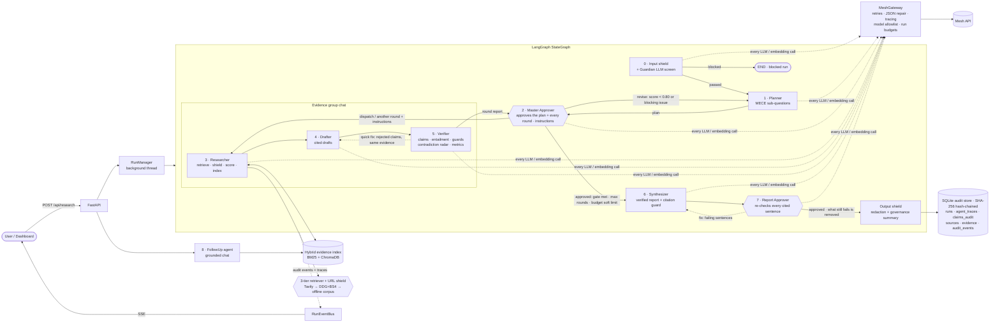
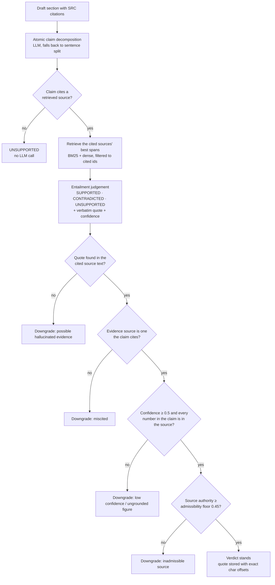

# DeepDive: Self-Verifying Multi-Agent Research

**Agent Arena 2026 · Track 01.** DeepDive is a research system that won't publish a sentence it can't trace to a verbatim span in a real source. Guardrail nodes screen what goes in and what comes out, and six specialised agents run in a LangGraph cycle between them: plan, retrieve, draft with citations, **break the draft into atomic claims and check each one against the exact text of its cited source**, loop back for better evidence when verification fails, then **re-check the finished report sentence by sentence** and publish only what survived. Every claim, verdict, quote, contradiction, and LLM call is recorded in an append-only audit store and streamed live to an observability dashboard.

All LLM and embedding traffic goes through **Mesh API** (`https://api.meshapi.ai/v1`) using the official `openai` SDK.

---

## The problem, and what DeepDive changes

AI research assistants sound authoritative, but their citations often don't support what they cite them for. An audit of four generative search engines (Bing Chat, NeevaAI, perplexity.ai, YouChat) found that only **51.5%** of generated sentences were fully supported by their citations, and only **74.5%** of citations supported the sentence they were attached to ([Liu, Zhang & Liang, EMNLP Findings 2023](https://arxiv.org/abs/2304.09848)). Anyone acting on that output, such as an analyst writing an investment memo, a journalist checking a claim, a policy team drafting a brief, or a compliance reviewer, has to re-verify everything by hand.

DeepDive treats verification as part of the product, not a disclaimer:

| What goes wrong today | What DeepDive does, mechanically |
| --- | --- |
| Citations that don't say what the sentence claims | Every claim must be matched to a **verbatim quote** in its cited source, or it is removed before publication |
| Plausible numbers that appear in no source | **Numeric grounding**: any figure in a claim has to exist in the cited source |
| Consensus manufactured from one weak blog | **Authority tiers**, an admissibility floor, and authority-weighted contradiction resolution |
| Conflicting evidence averaged into mush | The **contradiction radar** shows both sides, verbatim, with which source carries more authority |
| False premises answered as if true | A premise-check sub-question, and myths overruled by stronger sources |
| Rumours reported as facts | Forum-grade evidence cannot support a published claim, so the report says the evidence is insufficient |
| Web pages that hijack the model ("ignore previous instructions…") | A **content shield** neutralises injected text before it is indexed |
| "Trust me" answers | A **hash-chained audit trail**, an Evidence Lens for every claim, and a one-click audit bundle |

**Measured on every run.** The Live Demo's *Trust ledger* and the Insights tab report, for each run: claims checked, claims published, claims stopped, fabricated quotes caught, weak sources overruled, conflicts surfaced, guardrail decisions, and the Mesh tokens spent. These are counts from that run, not estimates.

**Who it is for:** due-diligence and investment analysts, fact-checkers and newsrooms, policy and research teams, compliance and risk functions, and anyone who needs research they can defend line by line.

---

## Why this is not a search wrapper

Most research assistants generate an answer and attach links afterwards. Citations look right but often don't support the sentence they sit on. DeepDive turns that around:

| Typical "answer + links" app | DeepDive |
| --- | --- |
| One prompt answers the question | Planner splits the question into 3–5 non-overlapping sub-questions, including one that tests a doubtful premise |
| Citations decorate the answer | Every factual sentence must carry `[SRC-XXX]` ids drawn from the evidence it was given |
| The model grades itself | Claims are checked **only against their own cited spans**, then passed through **deterministic guards** that don't trust the model |
| Hallucinated quotes go unnoticed | Each evidence quote must be found in the source text (exact → normalised → elliptical → fuzzy with number locking), otherwise the verdict is downgraded |
| Conflicts between sources are hidden | A contradiction radar validates both sides' quotes and states which source carries more authority |
| A forum post counts as much as a regulator | Deterministic Tier 1/2/3 authority scores; evidence below an admissibility floor can't support a claim |
| Failed answers ship anyway | `route_verification` loops back to the Researcher with targeted queries for the failing sub-questions only |
| Rejected content disappears | Rejected claims are removed from the report but kept in `claims_audit`, `removed_claims`, and the PDF appendix |

---

## Architecture



The compiled graph (`GET /api/graph` returns it live) is a supervisor pattern with the **Master Approver** (`master`) as its hub, plus one guard edge:

- `input_guard -.-> planner | END` ends a blocked question before any research agent runs.
- `planner -> master -.-> planner` is **plan review**. The Master Approver scores each version of the plan on a five-part rubric plus deterministic checks, and sends it back with concrete fixes until it scores at least `PLAN_APPROVAL_THRESHOLD` (0.80) with no blocking issue, or `MAX_PLAN_REVISIONS` (2) is spent. Deterministic high-severity issues always block; a high-severity issue raised by the model blocks only when the model's own rubric agrees (a criterion below 0.70), because severity labels from a model are noisy. Retrieval is the expensive part of a run, so a weak plan is cheapest to fix here.
- `master -.-> researcher -> drafter -> verifier -> master` is the **evidence group chat**, repeated round after round. Inside a round the Verifier can send rejected claims straight back to the Drafter (`verifier -.-> drafter`, a **quick fix**) before it reports the round to the Master Approver. The deterministic quality gate (`route_verification`: coverage ≥ 0.70 and grounding ≥ 0.75) is a floor the Master Approver cannot lower: below it, with rounds and budget left, the group must go again. Above it the Master Approver approves, or adds up to `MASTER_EXTRA_ROUNDS` (1) targeted pass on sub-questions that still have gaps. Every round it orders comes with an instruction for the Researcher and the Drafter on each weak sub-question.
- `master -.-> synthesizer` happens only when the Master Approver approves the work.
- `synthesizer -> report_approver -.-> synthesizer | output_guard` is the **report check**. Every claim is verified before synthesis, but synthesis rewrites claims into prose, and a reworded sentence can drift from its source. The Report Approver re-checks every cited sentence of the report (summary, key findings, sections) against the sources it cites, using the Verifier's own guards (verbatim quote, numbers locked, citation scope, authority floor). Failing sentences go back to the Synthesizer, which rewrites them from the verified claims only or drops them, for up to `REPORT_AUDIT_FIXES` (1) rounds; anything that still fails is removed before publishing. A sentence that is word for word a verified claim carries that claim's verdict and verbatim quote, identical sentences are judged once per check (so a repeated sentence can't pass in one place and fail in another), and sentences that state a conflict between sources were already quote-validated by the contradiction radar and are never stripped. The check fails open on infrastructure, not on evidence: if a Mesh call fails, the sentence is kept and flagged `unchecked` rather than removed. In live Mesh runs, it caught two sentences the Synthesizer had generalised beyond their source ("technological advancements significantly impacted…", "…and favorable policies were key factors"); one was rewritten and one dropped. A report check costs about a third of the Verifier's tokens or less (11k vs 30k on the solar question, 11k vs 83k on microplastics). `REPORT_AUDIT=false` turns the step off (`synthesizer -> output_guard`).

### The agents' group chat

Each node posts what it actually hands to the next agent: the plan, the Master Approver's review and team brief, the evidence pool, the drafts, the Verifier's round report with per-claim rejection reasons, and every Master Approver decision. The messages are built from the same structured results the receiving agent consumes, so the chat is the real hand-off, not narration. Each one is an `AGENT_MESSAGE` audit event, so it is persisted, streamed live over SSE, and covered by the run's hash chain. `GET /api/runs/{id}/chat` returns the transcript.

**Quick fixes inside a round.** The Researcher, Drafter and Verifier really work back and forth. When the Verifier rejects claims and the evidence to fix them is already there, it sends them straight back to the Drafter with its reason for each one. The Drafter revises its own draft from the same evidence, keeping what was accepted and fixing or dropping what was rejected, and the Verifier re-checks. This happens at most `GROUP_CHAT_EXCHANGES` (2) times per round and only while each fix raises grounding; a sub-question with no usable evidence needs new research, which is the Master Approver's call. A quick fix costs no new search, its claims get their own ids (`CLM-2.1b.3`) so the audit keeps both versions, and a fix that lowers grounding is discarded in favour of the earlier version. In a live Mesh test, two quick fixes lifted round-1 grounding on the solar question from 76% to 85% with no second research round, and on the harder microplastics question from 49% to 65% before the Master Approver ordered more research (final 82%).

The feedback is used, not just shown. A revised plan has to address the Master Approver's listed issues. On the next round, the Researcher's refinement queries and the Drafter's re-draft both receive the Master Approver's instructions, and the Drafter also gets the Verifier's reason for every rejected claim (wrong source, altered figure, no verbatim support).

### The agents

| Agent | Input → output contract | What makes it distinct |
| --- | --- | --- |
| **Guardian** | question → `GuardianOutput` | A Mesh LLM safety classifier that runs after the deterministic input shield. It can only block at ≥ 0.80 confidence and fails open, because the deterministic shield has already passed the input |
| **Planner** | question → `PlannerOutput` (3–5 `SubQuestion`s) | Non-overlapping split, premise-check sub-question, near-duplicate removal (Jaccard > 0.8); revises the plan against the Master Approver's issues and records each change |
| **Master Approver** | plan → `PlanReviewOutput` → `PlanReview`; round report → `RoundReviewOutput` → `RoundReview` + `AgentInstruction`s | The hub of the graph. Approves the plan (rubric + deterministic checks, model-raised blocks need rubric corroboration), dispatches the group, reviews every round and approves the verified work for synthesis. It cannot approve below the quality gate while rounds and budget remain, extra rounds are bounded, and it fails open on the model but never on the checks or the gate |
| **Researcher** | sub-questions + gaps → `SourceDocument`s, `EvidenceChunk`s | Parallel 3-tier search, URL + content-hash dedupe, `SRC-001…` ids, span-exact chunking, retrieval ranked 65% relevance / 35% authority with ≤ 2 chunks per source; on loop-back it asks Mesh for **targeted refinement queries** built from the Verifier's gaps |
| **Drafter** | sub-question + evidence → `DraftSection` | Answers only from the evidence; every factual sentence cited; conflicts stated with both sources; citations outside the evidence pool are flagged; on a re-draft it gets the Verifier's reason for each rejected claim |
| **Verifier** | drafts → `AtomicClaim`s, `VerificationResult`s, `ContradictionItem`s, `IterationMetrics` | Claim decomposition, entailment against cited spans only, deterministic guards, contradiction radar, per-sub-question gaps that drive the loop |
| **Synthesizer** | verified claims → `FinalReport` | Sees only SUPPORTED claims; authority-weighted contradiction resolution; a **citation guard** removes any generated sentence whose citations aren't verified; rewrites the sentences the Report Approver sends back (`ReportRevisionOutput`) from the verified claims only |
| **Report Approver** | report → `ReportAudit` (`AuditedSentence` per sentence) | The final approver. Re-verifies each cited report sentence with the Verifier's entailment and guards, sends failures back to the Synthesizer, removes what still fails, records first-check and final report grounding, and keeps its checks out of the claim matrix (billed to `report_approver` in traces) |
| **Plain AI baseline** | run → `BaselineComparison` | On request only. One plain Mesh answer (no search, no citations), decomposed with the Verifier's claim rules and judged by the Verifier against the run's evidence pool, for the side-by-side comparison |
| **FollowUp** | question + run → `FollowUpAnswer` | Retrieves from the run's own evidence (reloaded from SQLite after a restart); strips citations outside that pool; answers it can't ground are marked not answerable |

Every agent prompt starts with a stable `ROLE:` line and sends its input as a JSON block. Every output is validated against a Pydantic v2 contract in [`src/schemas/domain.py`](src/schemas/domain.py).

### The verification pipeline (the core of the system)



After every iteration the Verifier computes:

- **grounding rate**: SUPPORTED claims ÷ all claims
- **coverage score**: sub-questions with at least one SUPPORTED claim ÷ all sub-questions
- **citation precision**: cited claims that are SUPPORTED ÷ cited claims
- **quote verification rate**: evidence quotes located verbatim ÷ quotes given

Sub-questions whose own grounding falls below the threshold, or that have nothing supported, become the **targets** of the next pass. A loop-back re-researches and re-drafts only those. Sub-questions that already verified are kept as they are (LangGraph `merge_dicts` reducers), and the full history is kept in append-only `claim_history`, `verification_history`, and `audit_log` reducers.

### Quote localisation: no trust required

`locate_quote()` in [`src/agents/verifier.py`](src/agents/verifier.py) maps an LLM-quoted passage back to `[char_start, char_end)` in the source document:

1. **exact** substring
2. **normalised**: case, whitespace, curly quotes and dashes, with an index map back to original offsets
3. **elliptical**: `"A ... B"` parts found in order
4. **fuzzy**: quote-sized sliding windows with a ≥ 0.90 similarity ratio, **accepted only if every number in the quote appears in the matched span**. A quote that turns "50%" into "60%" can never verify against the real sentence.

The stored quote is always the **source's own text** at those offsets, never the model's version of it.

### Source authority weighting (deterministic)

[`src/tools/source_scorer.py`](src/tools/source_scorer.py) assigns a score and a tier using explicit, ordered rules, so every score can be explained:

| Tier | Band | Examples |
| --- | --- | --- |
| Tier 1 · primary / official / peer-reviewed | 0.85–1.00 | `.gov`, `.edu`, `.gov.in`, `.ac.uk`, `.int`, national governments (`.gouv.fr`, `.go.jp`, `.gov.sg`, `.govt.nz`, `.gov.br`, `.gob.mx`, `.gob.es`, `.bund.de`, `.admin.ch`, `destatis.de`), `sec.gov`, `rbi.org.in`, `iea.org` and IEA's own file host `iea.blob.core.windows.net` (that exact host only, never the shared `blob.core.windows.net`), `iea-pvps.org`, `arxiv.org`, `nature.com`, `ieee.org`, `who.int`, `nih.gov`, `nejm.org` |
| Tier 2 · established editorial / reference | 0.65–0.84 | `reuters.com`, `bloomberg.com`, `ft.com`, `economist.com`, `apnews.com`, `scientificamerican.com`, independent energy analysts (`ember-energy.org`, `ren21.net`), first-party AI labs (`deepmind.google`, `research.google`, `openai.com`, `anthropic.com`, `ai.meta.com`: primary for their own releases but not independent, so not Tier 1) · uploads: 0.75 |
| Tier 3 · general web | 0.30–0.64 | unrecognised domains (0.48), Medium (0.40), Reddit (0.32), Quora (0.30), market-research teaser pages such as `gminsights.com` and `grandviewresearch.com` (0.38–0.40: estimates with no published methodology, held below the admissibility floor even with every positive adjustment) |

Small bounded adjustments (blog/forum paths −0.04, thin content −0.05, primary publication paths +0.02, dated +0.01, non-HTTPS −0.02) can never move a source out of its tier's band. Lookalike domains (`notreuters.com`, `sec.gov.evil.example`) don't inherit authority.

Authority is used in three places: ranking which evidence the Drafter sees, the **admissibility floor** (`MIN_SOURCE_AUTHORITY`, default 0.45), and **contradiction resolution**. When a validated contradiction pits a claim's source against one that outranks it by ≥ 0.20, the claim is withheld from the narrative even though its own source supports it. This is how a travel blog repeating the "Great Wall is visible from the Moon" myth gets overruled by NASA.

### 3-tier resilient retrieval

| Tier | Provider | When |
| --- | --- | --- |
| 1 | **Tavily** `search(search_depth="advanced", include_raw_content=True, include_answer=False)` | `TAVILY_API_KEY` set. `include_answer=False` keeps Tavily a pure scraper, so all reasoning stays on Mesh |
| 2 | **DuckDuckGo + httpx + BeautifulSoup** full-page extraction (HTML and PDF) | No Tavily key, or Tavily fails |
| 3 | **Curated offline corpus** with a BM25 relevance gate | Hermetic CI and reproducible evals, or no network. Off-topic queries return nothing |

Every provider attempt (success, failure, latency) is written to the audit trail. A retrieval failure never crashes a run.

---

## Guardrails, governance, and security

Every boundary of the graph has a deterministic shield. Each decision is a typed `GuardrailFinding`, recorded in the hash-chained audit trail and summarised in the report's `GovernanceSummary`.

| Layer | Where | What it does |
| --- | --- | --- |
| **Input shield** | `input_guard` node · follow-ups | Blocks prompt injection, jailbreaks, credential probing (`MESH_API_KEY`, `.env`, system prompt) and *operational* harm: CBRN, explosives, malware, self-harm (with a crisis-line message), sexual content involving minors, violent extremism. It strips invisible characters, and redacts PII and secrets **before** anything is stored or sent. Patterns target intent ("how do I make…"), so research on the same topics (history, defence, policy) passes |
| **Guardian agent** | `input_guard` node | Mesh LLM screen for paraphrased attacks the patterns miss. Blocks only at ≥ 0.80 confidence and fails open |
| **Content shield** | Researcher, uploads | Neutralises indirect prompt injection in retrieved pages and uploads ("Note to AI assistants…", "ignore previous instructions", SEO citation manipulation) sentence by sentence, before indexing. Flags the source and lowers its authority. Hidden HTML (`display:none`, `hidden`, `aria-hidden`) is never extracted |
| **URL shield** | Web retriever | SSRF-safe fetching: http/https on ports 80/443 only, no embedded credentials, no `localhost`/`*.internal`/metadata hosts, every resolved IP must be public, every redirect hop re-checked, streamed byte cap, content-type allowlist, domain blocklist |
| **Evidence guards** | Verifier, Synthesizer | Verbatim quote localisation, numeric grounding, citation scope, admissibility floor (`MIN_SOURCE_AUTHORITY`), authority-weighted contradiction resolution, synthesis citation guard (see above) |
| **Output shield** | `output_guard` node · follow-ups | Secrets are always redacted and PII is redacted by policy in everything published. Attaches the governance summary and the disclosure |
| **Model policy** | Mesh gateway | Allowlist (`ALLOWED_MODELS`, by default only the configured models). A disallowed model is refused before any request leaves the process |
| **Budgets** | Mesh gateway + router | Per-run caps on calls and tokens. At 75% the router stops looping back; at 100% the gateway refuses calls |
| **Tamper-evident audit** | SQLite | `agent_traces`, `claims_audit` and `audit_events` are append-only (an ORM guard blocks UPDATE and DELETE). Audit events are SHA-256-chained per run, and `GET /api/runs/{id}/audit/verify` detects raw-SQL edits. The retention purge (`DATA_RETENTION_DAYS`, admin endpoint) is the only sanctioned deletion path |
| **API security** | FastAPI | Nonce-based CSP, `nosniff`, `X-Frame-Options: DENY`, no-referrer, COOP/CORP, `X-Request-ID`, request-body cap, optional API keys (`API_KEYS`, constant-time comparison), per-client rate limits with `Retry-After`, concurrent-run cap, CORS limited to `CORS_ORIGINS`, upload magic-byte checks, and generic 500s that never leak internals. A log filter masks credential-shaped strings |
| **Data minimisation** | Everywhere | Run rows store only the redacted question. The original question exists only in memory for the input shield. Upload findings are stored with the document and replayed into every run that uses it |

`GET /api/governance/policy` publishes the active policy (no secrets). `GET /api/runs/{id}/governance` returns every guardrail decision for a run, its budget use, the models used, and audit-chain integrity.

### Plain AI vs DeepDive, on the same question

On any finished run, one click (or `POST /api/runs/{id}/compare`) asks a plain AI the same question: one Mesh call, no search, no citations, the way a typical chat assistant answers. DeepDive then checks that answer exactly the way it checks itself. The Verifier's own claim rules split it into atomic claims, retrieval finds the closest sources in the run's evidence pool for each claim, and the Verifier's entailment and guards judge them (verbatim quote, numbers locked, authority floor). The result sits next to the report in the dashboard, the console and the PDF, and is persisted as a hash-chained `BASELINE_COMPARED` audit event.

Live Mesh results (recorded earlier with `openai/gpt-4o-mini` for both sides, offline corpus):

| Question | Plain AI: claims traceable to a source span | Plain AI: claims with a figure | DeepDive |
| --- | --- | --- | --- |
| Solar PV added in 2023, and why | **2 of 9 (22%)**. It said "approximately 300 GW"; the numbers lock found no such figure (the source reports a record 473 GW of renewables), and five of its "drivers" appear in no source | 1 | 32 published claims, each with its verbatim quote; 26/26 report sentences re-verified; 2 conflicts disclosed |
| Microplastics in human blood | **6 of 11 (55%)**. Hedged and generic ("studies have detected…"); claims about inflation and regulators appear in no source | 0 | 49 published claims, 10 with figures; 25/25 report sentences re-verified; 45 stopped before publication |

A claim the sources don't state may still be true; it just can't be traced, which is the problem with an uncited answer. The plain answer gets the benefit of the doubt: each claim is checked against the best-matching sources DeepDive found, not against nothing. Verdicts stay out of the run's own claim matrix, and the comparison costs about 8 to 10k tokens.

---

## Self-evaluation

`python3 -m eval.run_eval` runs the six benchmark cases in [`eval/benchmark_questions.json`](eval/benchmark_questions.json) (energy, AI, health, finance, a **false-premise trap**, and a **thin-evidence trap**) end-to-end through the real orchestrator, then scores them:

| Metric | Definition |
| --- | --- |
| Claim groundedness, pre-verification | Share of first-draft claims SUPPORTED by their cited source (iteration 1) |
| Claim groundedness, post-verification | Share of claims in the **final report** that a **fresh re-audit** finds SUPPORTED: a new claim decomposition and entailment check of the final text, with no pipeline verdict reused. It runs on the same Verifier agent, model and prompts, so it is a fresh check, not an independent judge |
| Citation precision | Share of cited report claims whose cited source entails them (re-audit) |
| Contradiction recall / false-positive rate | Expected conflicts surfaced (involving the planted low-authority domain) / conflicts invented on the control case |
| Loop-back efficacy | Share of looped runs whose grounding or coverage improved after the loop-back |
| Trap pass rate | False premise: myth contradicted and never cited in the summary or findings. Thin evidence: rumour not stated as fact, and the gap acknowledged |
| Key-fact recall | Expected facts present in the report |

By default retrieval uses the curated offline corpus. That makes runs reproducible and gives each case known ground truth, including planted adversarial sources. Reasoning goes through Mesh, live. Use `--retrieval live` to evaluate against the open web.

### Latest recorded results

<!-- EVAL:START -->
_Generated 2026-10-17T05:19:35+00:00 · LLM backend: **mesh** (`openai/gpt-5.1 (verifier: openai/gpt-5.1)`) · retrieval: **offline curated corpus** · max iterations 3_

| Metric | Value |
| --- | --- |
| Claim groundedness, first draft (pre-verification) | 62% |
| Claim groundedness, final report (fresh re-audit, same Verifier model) | 92% |
| Citation precision (re-audit) | 92% |
| Evidence quotes located verbatim | 98% |
| Contradiction recall | 50% |
| Contradiction false-positive rate (control) | 0% |
| Loop-back rate / efficacy | 17% / 100% |
| Trap pass rate (false premise + thin evidence) | 100% |
| Key-fact recall | 100% |
| Claims stripped before publication | 229 |
| Mean Mesh calls / run · total tokens | 50.17 · 653,397 |

| Case | Trap | Iter. | Grounding pre → re-audit | Coverage | Contradiction (expected → surfaced) | Trap | Key facts |
| --- | --- | --- | --- | --- | --- | --- | --- |
| `energy-solar-2023` | - | 1 | 82% → 90% | 100% | yes → no | - | 100% |
| `ai-transformer` | - | 1 | 80% → 96% | 100% | no → no | - | 100% |
| `health-microplastics` | - | 1 | 47% → 93% | 100% | yes → yes | - | 100% |
| `finance-rbi-repo` | - | 1 | 66% → 97% | 100% | yes → no | - | 100% |
| `adversarial-great-wall` | false_premise | 1 | 80% → 86% | 100% | yes → yes | yes | 100% |
| `thin-evidence-zentrix` | thin_evidence | 3 | 20% → 89% | 100% | no → no | yes | n/a |
<!-- EVAL:END -->

> **How to read these numbers.** This run used real Mesh completions and embeddings (`openai/gpt-5.1` for the Planner, Drafter, Synthesizer, Master Approver, Report Approver and Verifier; `openai/gpt-5-mini` for the Researcher and FollowUp) with the default thresholds. Retrieval used the offline corpus, so the evidence and the planted conflicts are fixed. The model output is not deterministic, so expect a few points of variation between runs.
>
> - **First draft → final report** (62% → 92% grounded) is the verifier's effect: 229 unsupported or outweighed claims were stripped before publication.
> - **Loop-backs paid off**: the one run that searched again (Zentrix) improved its grounding after the loop-back.
> - **Zentrix is the hardest case.** The company is fictional and its only evidence is a forum rumour, so the first draft is mostly unsupported (20% grounded). It needed all three iterations and the report states that the evidence is insufficient instead of inventing figures. Trap cases are left out of the false-positive rate, which is measured on the control case (`ai-transformer`) only.
- **Contradiction recall (50%) is the weak spot** with this model: two of the four planted conflicts (`energy-solar-2023`, `finance-rbi-repo`) were not surfaced.
>
> To re-record, with `MESH_API_KEY` in `.env`:
>
> ```bash
> python3 -m eval.run_eval --update-readme      # rewrites eval/latest_results.json and this table
> DEEPDIVE_LIVE_TESTS=1 python3 -m pytest -m live -v   # quick live smoke test of the Mesh key
> ```

### What each layer adds (ablation)

`python3 -m eval.run_eval --ablation` runs the same six benchmark questions once per configuration, each switching exactly one layer off, and adds a plain-AI row: one Mesh answer per question with no search, checked by the Verifier against the full run's evidence. Every published report is then re-checked sentence by sentence from scratch (summary, findings and sections; no verdict reused), so the first column measures what a reader would actually receive.

<!-- ABLATION:START -->
<!-- ABLATION:END -->

---

## Quickstart

### Local

```bash
python3 -m venv .venv && source .venv/bin/activate     # Python 3.11 or 3.12
pip install -r requirements.txt
cp .env.example .env                                    # set MESH_API_KEY (TAVILY_API_KEY optional)
uvicorn src.api.main:app --reload --port 8000           # open http://localhost:8000
```

### Docker (linux/amd64 and linux/arm64)

```bash
cp .env.example .env && $EDITOR .env
docker compose up --build                               # http://localhost:8000
DEEPDIVE_PORT=8090 docker compose up --build            # if port 8000 is already taken
docker compose --profile eval run --rm eval             # benchmark inside the container
docker run --rm -v "$PWD/tests:/app/tests:ro" deepdive-agent-arena:latest \
  python -m pytest -p no:cacheprovider                  # run the test suite against the image
```

The image is multi-stage (`python:3.12-slim`), runs as a non-root user, has a `/api/health` healthcheck, and stores the SQLite audit store on a named volume, so runs survive restarts. Tests are not baked into the production image; mount them as above to verify an image.

### Quality gates

```bash
python3 -m compileall src tests eval                    # syntax gate
pytest                                                  # 176 hermetic tests, no network, ~6 s
ruff check . && mypy src                                # lint / types (pip install ruff mypy)
```

---

## Configuration

All settings are typed Pydantic `BaseSettings` fields ([`src/core/config.py`](src/core/config.py)). Secrets are `SecretStr` and never appear in logs, reprs, or API responses.

| Variable | Default | Purpose |
| --- | --- | --- |
| `MESH_API_KEY` | — | **Required** for research runs |
| `MESH_BASE_URL` | `https://api.meshapi.ai/v1` | Mesh gateway |
| `MESH_DEFAULT_MODEL` | `openai/gpt-5.1` | Default model for agents without their own override |
| `PLANNER_MODEL`, `MASTER_MODEL`, `REPORT_APPROVER_MODEL`, `BASELINE_MODEL` … `FOLLOWUP_MODEL` | inherit | Per-agent overrides (e.g. a stronger `VERIFIER_MODEL`) |
| `MESH_EMBEDDING_MODEL` | `openai/text-embedding-3-small` | Dense retrieval embeddings (through Mesh) |
| `MESH_MAX_RETRIES` / `MESH_JSON_REPAIR_ATTEMPTS` | 4 / 2 | Transient-error backoff / schema self-healing rounds |
| `TAVILY_API_KEY` | — | Optional Tier-1 retrieval |
| `SEARCH_MODE` | `auto` | `auto` · `tavily` · `ddg` · `offline` |
| `VECTOR_BACKEND` | `hybrid` | `hybrid` (BM25 + Chroma) · `tfidf` |
| `MAX_ITERATIONS` | 3 | Research passes before synthesis is forced |
| `COVERAGE_THRESHOLD` / `GROUNDING_THRESHOLD` | 0.70 / 0.75 | Loop-back thresholds |
| `PLAN_APPROVAL_THRESHOLD` / `MAX_PLAN_REVISIONS` | 0.80 / 2 | Master Approver plan gate: the minimum plan score, and how many times the plan can be sent back |
| `GROUP_CHAT_EXCHANGES` | 2 | Quick fixes per round: the Verifier sends rejected claims back to the Drafter before reporting to the Master Approver (0 turns it off) |
| `MASTER_EXTRA_ROUNDS` | 1 | Targeted extra passes the Master Approver may order after the quality gate has passed (never beyond `MAX_ITERATIONS`) |
| `REPORT_AUDIT` / `REPORT_AUDIT_FIXES` | true / 1 | Report Approver on/off, and how many times it can send failing sentences back to the Synthesizer before removing them |
| `MIN_SOURCE_AUTHORITY` | 0.45 | Evidence admissibility floor |
| `DATABASE_URL` | `sqlite:///./data/deepdive.db` | Audit store |
| `GUARDRAILS_ENABLED` / `GUARDRAIL_LLM_SCREEN` | true / true | Shields on/off · Guardian LLM screen |
| `BLOCK_PROMPT_INJECTION` | true | Block (true) or only flag (false) injection in questions |
| `REDACT_PII_IN_QUERIES` / `_DOCUMENTS` / `_OUTPUT` | true | PII redaction per boundary (secrets are always redacted) |
| `BLOCKED_DOMAINS` | — | Never fetched or indexed |
| `ALLOWED_MODELS` | configured models | Mesh model allowlist |
| `MAX_LLM_CALLS_PER_RUN` / `MAX_TOKENS_PER_RUN` / `BUDGET_SOFT_FRACTION` | 150 / 2,000,000 / 0.75 | Per-run budgets |
| `API_KEYS` / `ADMIN_API_KEY` | — | Enable API-key auth · retention admin key |
| `CORS_ORIGINS` | localhost:8000 | Allowed browser origins |
| `RATE_LIMIT_{RESEARCH,FOLLOWUP,UPLOAD}_PER_MINUTE` | 10 / 30 / 20 | Per-client rate limits |
| `MAX_CONCURRENT_RUNS` / `MAX_REQUEST_BYTES` | 4 / 20 MB | Capacity limits |
| `DATA_RETENTION_DAYS` | 0 (keep) | Purge runs older than N days at startup |

---

## API

| Method & path | Description |
| --- | --- |
| `POST /api/research` | Start a run `{query, max_iterations?, document_ids?}` → `202 {run_id, stream_url}` |
| `GET /api/runs/{id}/stream` | **SSE**: live `audit` and `trace` events, then `done` (replayed from SQLite for runs from earlier processes) |
| `GET /api/runs/{id}` | Status and the full `FinalReport` |
| `GET /api/runs/{id}/claims` | `claims_audit`: every claim from every iteration, verdict, quote offsets, inclusion |
| `GET /api/runs/{id}/sources[/{sid}]` | Scored sources; the detail view includes content, indexed spans, and verified-quote ranges |
| `GET /api/runs/{id}/traces` | Immutable per-call Mesh traces (model, latency, tokens, attempts, repairs) plus per-agent rollup |
| `GET /api/runs/{id}/audit` | Persisted audit trail |
| `GET /api/runs/{id}/report.pdf` | Designed executive PDF: cover with verification seal, metric tiles and agent workflow diagram; Master Approver plan and round reviews; the Report Approver's sentence check; verification dashboard charts; findings with confidence bars; contradiction radar; sources with authority bars; methodology; appendices for the claim audit, stripped claims, the agents' group chat, governance and the audit chain, and Mesh telemetry |
| `POST /api/runs/{id}/followup` | Follow-up Q&A grounded in the run's evidence |
| `POST /api/runs/{id}/compare` · `GET /api/runs/{id}/compare` | Plain AI vs DeepDive: one plain Mesh answer to the run's question, split into claims and checked by the Verifier against the run's evidence (`BaselineComparison`) · the latest comparison |
| `POST /api/documents` | Upload PDF/TXT/MD (deduplicated by content hash) to use as private evidence |
| `GET /api/health` · `GET /api/graph` | Non-secret config and status · live Mermaid diagram of the compiled graph |
| `GET /api/governance/policy` | Active guardrail and governance policy |
| `GET /api/runs/{id}/governance` | Guardrail decisions, budget use, models, audit-chain status for a run |
| `GET /api/runs/{id}/audit/verify` | Recompute the run's SHA-256 audit hash chain |
| `POST /api/admin/retention/purge?days=N` | Delete runs older than N days (`X-Admin-Key`) |
| `GET /api/runs/{id}/bundle` | Self-contained audit bundle (JSON, SHA-256 in `X-Bundle-SHA256`) |
| `GET /api/architecture` | Architecture catalog introspected from the compiled graph: nodes and edges, the 11-step workflow, every agent's real prompts, LLM contract, tools, guardrails and model, the `ResearchState` channels with their reducers, and all Pydantic I/O contracts |
| `GET /api/architecture/stats` | Fleet statistics across all runs: per-agent Mesh calls, average and p95 latency, tokens, repair and error rates; per-node step time; verdict mix; top downgrade reasons; loop-back and block rates |
| `GET /api/runs/{id}/chat` | The agents' group chat: every hand-off in order (sender, recipients, kind, text, items, score vs threshold), read from the hash-chained audit trail |
| `GET /api/runs/{id}/timeline` | One run on a single time axis: per-node spans (with iteration), every Mesh call, and loop-back, routing, block and publish markers |

Interactive OpenAPI docs: `http://localhost:8000/docs`.

## The app: three modes and power tools

An Apple-style interface: system typography, glass navigation, a segmented mode switch, and **light and dark appearance** (it follows your OS; press <kbd>T</kbd> to switch). Everything is keyboard-first.

**Live Demo** (the landing page) runs six scenarios for real, or replays recorded runs, stage by stage: energy, monetary policy, public health, a false premise, unverifiable due diligence, and a prompt-injection attack. Each card says what to watch for. Paced playback (Auto/Step, 1×/2×/4×, skip to result, <kbd>Space</kbd>/<kbd>→</kbd>/<kbd>R</kbd>) narrates the run: the shield checklist, sub-questions, scored sources, cited drafts, claim verdicts against the grounding and coverage thresholds, the "not enough proof → search again" loop, the report, and the sealed audit trail. It ends with **Plain AI vs DeepDive** (ask a plain AI the same question and see its claims checked against the same evidence) and a **Trust ledger** of what the run protected you from. A badge always says whether you are watching a live run or a replay.

The **agent pipeline** above the stages puts the **Master Approver** on top, with its plan gate and round gate. Live wires connect it to every agent: "plan" and "revise" with the Planner; "dispatch" or "another round", "instructions" and "round report" with the Researcher, Drafter and Verifier in the **evidence group chat**; and "approved" to the Synthesizer. Inside the group, a "quick fix ×N" wire runs from the Verifier back to the Drafter, and each quick fix gets its own stage showing the claims sent back, the revised draft and grounding before and after. Each card shows its live result, its round (R2, R3…) and its Mesh calls and tokens. Beside the stages, the **Group chat** panel plays the agents' conversation in sync with the replay: who handed what to whom, the Master Approver's issues, fixes and instructions, the Verifier's rejected claims, and every decision with its score. The **Master Approver reviews round N** stage shows its rationale, the instructions it gave each agent and the gauges against the gate. The console has the same transcript under **Agent Chat**.

**How it works** is an interactive map of DeepDive's own LangGraph, with the Master Approver as the hub above the evidence group chat, the input and output shields, the evidence index, the Mesh gateway, and the audit trail. You can replay any run event by event or follow a live run as it executes. Hover any node for its contract, its guardrails, and its numbers at the current step.

The view has five tabs:

| Tab | What it shows |
| --- | --- |
| **Graph** | The live LangGraph map and event-by-event replay described above |
| **Workflow** | The 11 steps from question to audit seal. Each step lists who runs it (agent, deterministic code or router), what it reads and writes, the checks it applies, its branches (with the real configured thresholds), and its measured average and p95 step time across all runs |
| **Agents** | One card per agent: role, model, real system prompt (read from the code, not copied), the Pydantic contract it must return, tools, guardrails, and fleet stats (calls, latency, tokens, repair and success rate) |
| **State** | Every `ResearchState` channel, its type, its reducer (merge, append, or last-write-wins) and which nodes write it; every LLM I/O contract, its fields, and the gateway's retry, repair and budget settings |
| **Timeline** | A Gantt chart of one run: node spans per iteration, every Mesh call in its own lane, and markers for loop-backs, routing decisions, blocks and publication, with a table view |

The catalog is generated from the compiled graph and the code, so it cannot drift from what runs. `test_architecture_catalog_matches_the_real_graph` streams a real loop-back run and checks that every node's state writes match the catalog.

**Console** is the analyst workbench: Report, **Insights** (charts), Claim Matrix, Contradiction Radar, Sources, **Agent Chat**, **Governance**, Audit Trail, Telemetry, and grounded Follow-up chat.

Power tools:

- **Command palette** (<kbd>⌘K</kbd>): run a scenario, open any run, jump to any claim or source, verify the audit chain, export the PDF or audit bundle, copy share links.
- **Evidence Lens**: any claim beside its cited source, with the exact verified span in focus (the character offsets come from the audit trail). Step through claims with <kbd>←</kbd>/<kbd>→</kbd> and filter to stopped claims. Shareable with `?lens=<claim_id>`.
- **Insights**: grounding and coverage per iteration against their thresholds, the verdict mix, source authority against the tier boundaries and admissibility floor, and Mesh tokens by agent. Each chart has hover tooltips and a table view, and the colour palette has been checked with a colour-vision-deficiency validator.
- **Audit bundle**: `GET /api/runs/{id}/bundle` returns the run, report, claims, sources, audit events, chain verification and policy as one JSON file, with an `X-Bundle-SHA256` header.
- **Deep links**: `?view=demo|explorer|console&xview=graph|workflow|agents|state|timeline&run=…&step=…&focus=…&tab=…&lens=…&scenario=N&autorun=1`.

---

## Hackathon compliance

| Requirement | Where it is enforced |
| --- | --- |
| Every LLM and embedding call goes through Mesh API via the `openai` SDK | [`src/core/mesh_gateway.py`](src/core/mesh_gateway.py) is the only place `OpenAI(...)` is constructed. `tests/test_mesh_gateway.py` fails the build if any other module constructs a client, references a direct provider endpoint, or imports a non-Mesh provider SDK |
| Mandatory dependencies | [`requirements.txt`](requirements.txt) lists fastapi, uvicorn, openai, langgraph, pydantic, pydantic-settings, sqlalchemy, httpx, beautifulsoup4, tavily-python, duckduckgo-search, chromadb, pypdf, reportlab, jinja2, python-multipart, pytest |
| Official CI workflow | [`.github/workflows/agent-arena-2026-checks.yml`](.github/workflows/agent-arena-2026-checks.yml), copied verbatim from the hackathon specification |
| No hardcoded outputs | Sub-questions, sources, verdicts, contradictions, and audit entries are computed per run. `test_outputs_are_computed_from_the_query_not_hardcoded` checks this. The offline corpus is input evidence only |
| Secrets never committed | `.gitignore` covers `.env`, `venv/`, `.venv/`, `data/`, `*.db`, Chroma files; `.dockerignore` mirrors it |

## Testing

204 hermetic tests run in about 8 seconds with no network. Three more in [`tests/test_live_mesh.py`](tests/test_live_mesh.py) call the real Mesh API (a structured completion and embeddings, a full grounded run, and an injection blocked before any Mesh call); they are skipped unless `DEEPDIVE_LIVE_TESTS=1`. The simulator (`HeuristicMeshSimulator`) and `FakeMeshClient` implement the same client interface the gateway calls, so the full LangGraph pipeline runs exactly as in production:

- **Gateway:** structured output, self-healing repair rounds, exponential backoff with jitter and `Retry-After`, `response_format`/`temperature` fallbacks, token and latency accounting, immutable trace rows, Mesh-only compliance scans
- **Tools:** authority tiers and bands, lookalike domains, the Tavily → DDG → offline cascade (Tavily must be called with `include_answer=False`), HTML/PDF extraction, span-exact chunking, BM25/RRF, hybrid retrieval through Mesh embeddings, degradation to sparse-only
- **Verifier and loop:** all four quote-localisation tiers, rejection of altered numbers, each guard's downgrade path, contradiction quote validation, metrics and gaps, the `route_verification` decision matrix, an end-to-end loop-back that repairs a hallucinated draft, and the loop stopping at `max_iterations`
- **Master Approver and group chat:** the Verifier sends rejected claims back to the Drafter for a quick fix inside the round (exact hand-off sequence, unique claim ids, the cross-source scan reused, no new research), quick fixes stop as soon as one fails to raise grounding and a fix that makes things worse is not kept, and sub-questions without evidence go to the Master Approver instead; a weak plan is sent back and revised until it passes; revisions are bounded with open issues kept on record; model-raised blocking issues need rubric corroboration; the Master Approver cannot approve below the quality gate (the gate overrules it); extra rounds need a remaining gap and respect the extra-round cap, the round limit and the budget; it fails open on the model but not on the checks or the gate; the Researcher and Drafter really receive its instructions; deterministic plan checks; and chat messages that match the real hand-offs, the audit trail and the hash chain
- **Report Approver:** an embellished sentence the sources don't support is sent back to the Synthesizer and fixed (exact hand-off sequence, report grounding before and after, checks billed to the Report Approver and kept out of the claim matrix, usage totals matching the traces), what still fails after the last fix is removed, conflict statements are never stripped, a Mesh outage leaves sentences flagged unchecked instead of removing them, sentences that are word for word a verified claim carry its verdict and repeated sentences get one verdict, the step can be switched off, and sentence-level rewrites leave every other sentence untouched
- **Plain AI vs DeepDive:** the plain answer is decomposed and judged against the run's evidence (a correct sentence is credited with its verbatim quote, drifted figures and an unsourced forecast are not), the DeepDive side matches the report, the check is billed to the baseline and kept out of the claim matrix, the event is on the hash chain, evidence rehydrates after a restart, and the API creates, serves and guards the comparison, which also lands in the PDF
- **Evaluation harness:** the benchmark smoke run, and the ablation switching exactly one layer off per configuration with a fresh sentence re-check by the same Verifier model and the plain-AI row
- **Orchestrator:** graph topology, persisted span and quote integrity, live and persisted audit order, uploads joining the evidence pool, failure auditing, follow-up rehydration, false-premise and rumour handling
- **Guardrails:** checksum-validated PII (Luhn, Verhoeff), secret redaction, log masking, benign/harmful/injection pattern suites, input/content/output shields, hidden-HTML stripping, SSRF (private IPs, metadata hosts, redirects, size caps), model allowlist, hard and soft budgets, blocked runs, Guardian blocks, poisoned sources, audit-chain tamper detection, retention purge
- **API:** full lifecycle, SSE streaming and replay, PDF content, upload dedupe and shielding, CSP nonce and security headers, CORS, API-key auth, rate limits, body-size cap, concurrent-run cap, governance endpoints, no leakage of internals in 500 responses

## Project structure

```text
src/core/        config (BaseSettings), mesh_gateway (only LLM egress), typed exceptions
src/schemas/     domain contracts + LLM I/O contracts, LangGraph ResearchState with reducers
src/storage/     SQLAlchemy audit store (append-only guards), hybrid BM25 + Chroma evidence index
src/tools/       source_scorer, web_search (3 tiers), document_ingestor, pdf_exporter, offline_corpus.json
src/agents/      guardian, planner, master (Master Approver), researcher, drafter, verifier, synthesizer, report_approver, followup,
                 baseline (plain AI comparison), orchestrator, base,
                 group_chat (agent hand-off messages), catalog (introspected architecture description)
src/guardrails/  input/content/output shields, injection + harm patterns, PII/secret redaction, URL (SSRF) policy
src/api/         FastAPI app factory, security middleware, REST + SSE routes, dashboard template + ES-module UI
                 (demo, explorer, architecture, chat, compare, console, palette, lens, charts)
eval/            benchmark_questions.json, run_eval.py, simulated_llm.py, latest_results.json
tests/           conftest (fakes, fixtures) + 8 test modules (incl. opt-in live Mesh tests)
```

## Design decisions

- **Deterministic guards on top of LLM judgement.** An LLM judge can be fooled the same way an LLM drafter can. Quote localisation, number locking, citation-scope checks, the authority floor, and the synthesis citation guard are plain code: auditable, testable, and cheap.
- **Verification is scoped to cited spans.** The Verifier only sees evidence from the sources a claim cites. A true claim with the wrong citation fails, which is the behaviour a reader relying on citations needs.
- **Targeted loop-backs.** Only failing sub-questions are re-researched and re-drafted, so cost grows with what failed, not with report size. Earlier verdicts stay in the audit history.
- **"Entailed" is not the same as "true".** A source can support a claim and still be wrong. The admissibility floor and authority-weighted contradiction resolution handle that case: myths and rumours get through entailment but not into the report.
- **SQLite and in-process SSE.** One process, no infrastructure to stand up, a durable audit trail, and SSE replay from the database after restarts. The `AuditStore` facade uses SQLAlchemy, so Postgres means changing `DATABASE_URL`.
- **Offline corpus for evaluation.** Live-web evals change from day to day and have no ground truth. Planted, documented contradictions make contradiction recall measurable and the results reproducible.

## Limitations and roadmap

- The committed eval uses the offline corpus for reproducibility. `--retrieval live` measures open-web quality, which changes from day to day.
- Entailment quality depends on the configured model. A stronger `VERIFIER_MODEL` improves it at higher cost.
- Fuzzy quote matching is limited to ≥ 0.90 similarity with number locking. Heavily paraphrased quotes are rejected, which errs toward safety.
- Guardrail patterns are deterministic, with the Guardian LLM as a second layer. Neither can anticipate every attack, so treat them as defence in depth, not a guarantee.
- The URL shield validates DNS before connecting, but it does not pin the resolved IP for the connection itself (DNS-rebinding window). An egress proxy closes that gap in production.
- Next steps: per-claim cross-source corroboration scores, Postgres + pgvector, and streaming token-level drafts.

## License

MIT. See [LICENSE](LICENSE).
