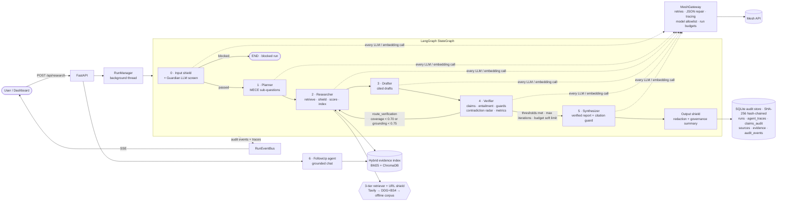
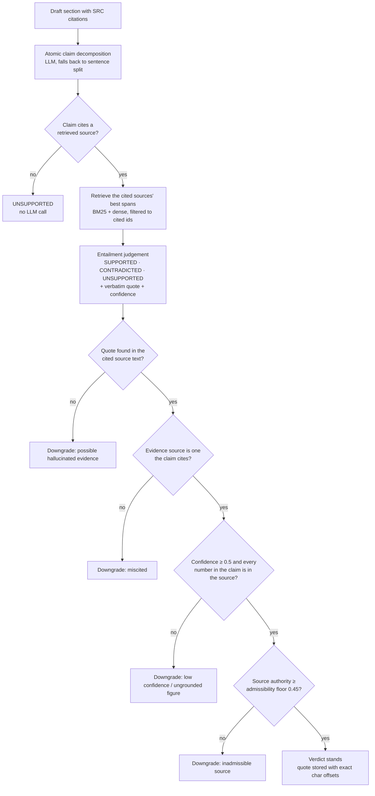

# DeepDive: Self-Verifying Multi-Agent Research

**Agent Arena 2026 · Track 01.** DeepDive is a research system that won't publish a sentence it can't trace to a verbatim span in a real source. Guardrail nodes screen what goes in and what comes out, and six specialised agents run in a LangGraph cycle between them: plan, retrieve, draft with citations, **break the draft into atomic claims and check each one against the exact text of its cited source**, loop back for better evidence when verification fails, then publish only what survived. Every claim, verdict, quote, contradiction, and LLM call is recorded in an append-only audit store and streamed live to an observability dashboard.

All LLM and embedding traffic goes through **Mesh API** (`https://api.meshapi.ai/v1`) using the official `openai` SDK.

---

## Why this is not a search wrapper

Most research assistants generate an answer and attach links afterwards. Citations look right but often don't support the sentence they sit on. DeepDive turns that around:

| Typical "answer + links" app | DeepDive |
| --- | --- |
| One prompt answers the question | Planner splits the question into 3–5 non-overlapping sub-questions, including one that tests a doubtful premise |
| Citations decorate the answer | Every factual sentence must carry `[SRC-XXX]` ids drawn from the evidence it was given |
| The model grades itself | Claims are checked **only against their own cited spans**, then passed through **deterministic guards** that don't trust the model |
| Hallucinated quotes go unnoticed | Each evidence quote must be found in the source text (exact → normalised → elliptical → fuzzy with number locking), otherwise the verdict is downgraded |
| Conflicts between sources are hidden | A contradiction radar validates both sides' quotes and states which source carries more authority |
| A forum post counts as much as a regulator | Deterministic Tier 1/2/3 authority scores; evidence below an admissibility floor can't support a claim |
| Failed answers ship anyway | `route_verification` loops back to the Researcher with targeted queries for the failing sub-questions only |
| Rejected content disappears | Rejected claims are removed from the report but kept in `claims_audit`, `removed_claims`, and the PDF appendix |

---

## Architecture



The compiled graph (`GET /api/graph` returns it live) has two conditional edges. `input_guard -.-> planner | END` ends a blocked question before any research agent runs. `verifier -.-> researcher | synthesizer` forms the self-correction cycle.

### The agents

| Agent | Input → output contract | What makes it distinct |
| --- | --- | --- |
| **Guardian** | question → `GuardianOutput` | A Mesh LLM safety classifier that runs after the deterministic input shield. It can only block at ≥ 0.80 confidence and fails open, because the deterministic shield has already passed the input |
| **Planner** | question → `PlannerOutput` (3–5 `SubQuestion`s) | Non-overlapping split, premise-check sub-question, near-duplicate removal (Jaccard > 0.8) |
| **Researcher** | sub-questions + gaps → `SourceDocument`s, `EvidenceChunk`s | Parallel 3-tier search, URL + content-hash dedupe, `SRC-001…` ids, span-exact chunking, retrieval ranked 65% relevance / 35% authority with ≤ 2 chunks per source; on loop-back it asks Mesh for **targeted refinement queries** built from the Verifier's gaps |
| **Drafter** | sub-question + evidence → `DraftSection` | Answers only from the evidence; every factual sentence cited; conflicts stated with both sources; citations outside the evidence pool are flagged |
| **Verifier** | drafts → `AtomicClaim`s, `VerificationResult`s, `ContradictionItem`s, `IterationMetrics` | Claim decomposition, entailment against cited spans only, deterministic guards, contradiction radar, per-sub-question gaps that drive the loop |
| **Synthesizer** | verified claims → `FinalReport` | Sees only SUPPORTED claims; authority-weighted contradiction resolution; a **citation guard** removes any generated sentence whose citations aren't verified |
| **FollowUp** | question + run → `FollowUpAnswer` | Retrieves from the run's own evidence (reloaded from SQLite after a restart); strips citations outside that pool; answers it can't ground are marked not answerable |

Every agent prompt starts with a stable `ROLE:` line and sends its input as a JSON block. Every output is validated against a Pydantic v2 contract in [`src/schemas/domain.py`](src/schemas/domain.py).

### The verification pipeline (the core of the system)



After every iteration the Verifier computes:

- **grounding rate**: SUPPORTED claims ÷ all claims
- **coverage score**: sub-questions with at least one SUPPORTED claim ÷ all sub-questions
- **citation precision**: cited claims that are SUPPORTED ÷ cited claims
- **quote verification rate**: evidence quotes located verbatim ÷ quotes given

Sub-questions whose own grounding falls below the threshold, or that have nothing supported, become the **targets** of the next pass. A loop-back re-researches and re-drafts only those. Sub-questions that already verified are kept as they are (LangGraph `merge_dicts` reducers), and the full history is kept in append-only `claim_history`, `verification_history`, and `audit_log` reducers.

### Quote localisation: no trust required

`locate_quote()` in [`src/agents/verifier.py`](src/agents/verifier.py) maps an LLM-quoted passage back to `[char_start, char_end)` in the source document:

1. **exact** substring
2. **normalised**: case, whitespace, curly quotes and dashes, with an index map back to original offsets
3. **elliptical**: `"A ... B"` parts found in order
4. **fuzzy**: quote-sized sliding windows with a ≥ 0.90 similarity ratio, **accepted only if every number in the quote appears in the matched span**. A quote that turns "50%" into "60%" can never verify against the real sentence.

The stored quote is always the **source's own text** at those offsets, never the model's version of it.

### Source authority weighting (deterministic)

[`src/tools/source_scorer.py`](src/tools/source_scorer.py) assigns a score and a tier using explicit, ordered rules, so every score can be explained:

| Tier | Band | Examples |
| --- | --- | --- |
| Tier 1 · primary / official / peer-reviewed | 0.85–1.00 | `.gov`, `.edu`, `.gov.in`, `.ac.uk`, `.int`, `sec.gov`, `rbi.org.in`, `iea.org`, `arxiv.org`, `nature.com`, `ieee.org`, `who.int`, `nih.gov`, `nejm.org` |
| Tier 2 · established editorial / reference | 0.65–0.84 | `reuters.com`, `bloomberg.com`, `ft.com`, `economist.com`, `apnews.com`, `scientificamerican.com` · uploads: 0.75 |
| Tier 3 · general web | 0.30–0.64 | unrecognised domains (0.48), Medium (0.40), Reddit (0.32), Quora (0.30) |

Small bounded adjustments (blog/forum paths −0.04, thin content −0.05, primary publication paths +0.02, dated +0.01, non-HTTPS −0.02) can never move a source out of its tier's band. Lookalike domains (`notreuters.com`, `sec.gov.evil.example`) don't inherit authority.

Authority is used in three places: ranking which evidence the Drafter sees, the **admissibility floor** (`MIN_SOURCE_AUTHORITY`, default 0.45), and **contradiction resolution**. When a validated contradiction pits a claim's source against one that outranks it by ≥ 0.20, the claim is withheld from the narrative even though its own source supports it. This is how a travel blog repeating the "Great Wall is visible from the Moon" myth gets overruled by NASA.

### 3-tier resilient retrieval

| Tier | Provider | When |
| --- | --- | --- |
| 1 | **Tavily** `search(search_depth="advanced", include_raw_content=True, include_answer=False)` | `TAVILY_API_KEY` set. `include_answer=False` keeps Tavily a pure scraper, so all reasoning stays on Mesh |
| 2 | **DuckDuckGo + httpx + BeautifulSoup** full-page extraction (HTML and PDF) | No Tavily key, or Tavily fails |
| 3 | **Curated offline corpus** with a BM25 relevance gate | Hermetic CI and reproducible evals, or no network. Off-topic queries return nothing |

Every provider attempt (success, failure, latency) is written to the audit trail. A retrieval failure never crashes a run.

---

## Guardrails, governance, and security

Every boundary of the graph has a deterministic shield. Each decision is a typed `GuardrailFinding`, recorded in the hash-chained audit trail and summarised in the report's `GovernanceSummary`.

| Layer | Where | What it does |
| --- | --- | --- |
| **Input shield** | `input_guard` node · follow-ups | Blocks prompt injection, jailbreaks, credential probing (`MESH_API_KEY`, `.env`, system prompt) and *operational* harm: CBRN, explosives, malware, self-harm (with a crisis-line message), sexual content involving minors, violent extremism. It strips invisible characters, and redacts PII and secrets **before** anything is stored or sent. Patterns target intent ("how do I make…"), so research on the same topics (history, defence, policy) passes |
| **Guardian agent** | `input_guard` node | Mesh LLM screen for paraphrased attacks the patterns miss. Blocks only at ≥ 0.80 confidence and fails open |
| **Content shield** | Researcher, uploads | Neutralises indirect prompt injection in retrieved pages and uploads ("Note to AI assistants…", "ignore previous instructions", SEO citation manipulation) sentence by sentence, before indexing. Flags the source and lowers its authority. Hidden HTML (`display:none`, `hidden`, `aria-hidden`) is never extracted |
| **URL shield** | Web retriever | SSRF-safe fetching: http/https on ports 80/443 only, no embedded credentials, no `localhost`/`*.internal`/metadata hosts, every resolved IP must be public, every redirect hop re-checked, streamed byte cap, content-type allowlist, domain blocklist |
| **Evidence guards** | Verifier, Synthesizer | Verbatim quote localisation, numeric grounding, citation scope, admissibility floor (`MIN_SOURCE_AUTHORITY`), authority-weighted contradiction resolution, synthesis citation guard (see above) |
| **Output shield** | `output_guard` node · follow-ups | Secrets are always redacted and PII is redacted by policy in everything published. Attaches the governance summary and the disclosure |
| **Model policy** | Mesh gateway | Allowlist (`ALLOWED_MODELS`, by default only the configured models). A disallowed model is refused before any request leaves the process |
| **Budgets** | Mesh gateway + router | Per-run caps on calls and tokens. At 75% the router stops looping back; at 100% the gateway refuses calls |
| **Tamper-evident audit** | SQLite | `agent_traces`, `claims_audit` and `audit_events` are append-only (an ORM guard blocks UPDATE and DELETE). Audit events are SHA-256-chained per run, and `GET /api/runs/{id}/audit/verify` detects raw-SQL edits. The retention purge (`DATA_RETENTION_DAYS`, admin endpoint) is the only sanctioned deletion path |
| **API security** | FastAPI | Nonce-based CSP, `nosniff`, `X-Frame-Options: DENY`, no-referrer, COOP/CORP, `X-Request-ID`, request-body cap, optional API keys (`API_KEYS`, constant-time comparison), per-client rate limits with `Retry-After`, concurrent-run cap, CORS limited to `CORS_ORIGINS`, upload magic-byte checks, and generic 500s that never leak internals. A log filter masks credential-shaped strings |
| **Data minimisation** | Everywhere | Run rows store only the redacted question. The original question exists only in memory for the input shield. Upload findings are stored with the document and replayed into every run that uses it |

`GET /api/governance/policy` publishes the active policy (no secrets). `GET /api/runs/{id}/governance` returns every guardrail decision for a run, its budget use, the models used, and audit-chain integrity.

---

## Self-evaluation

`python3 -m eval.run_eval` runs the six benchmark cases in [`eval/benchmark_questions.json`](eval/benchmark_questions.json) (energy, AI, health, finance, a **false-premise trap**, and a **thin-evidence trap**) end-to-end through the real orchestrator, then scores them:

| Metric | Definition |
| --- | --- |
| Claim groundedness, pre-verification | Share of first-draft claims SUPPORTED by their cited source (iteration 1) |
| Claim groundedness, post-verification | Share of claims in the **final report** that an **independent re-audit** (fresh claim decomposition and entailment, separate from the pipeline's own verdicts) finds SUPPORTED |
| Citation precision | Share of cited report claims whose cited source entails them (re-audit) |
| Contradiction recall / false-positive rate | Expected conflicts surfaced (involving the planted low-authority domain) / conflicts invented on the control case |
| Loop-back efficacy | Share of looped runs whose grounding or coverage improved after the loop-back |
| Trap pass rate | False premise: myth contradicted and never cited in the summary or findings. Thin evidence: rumour not stated as fact, and the gap acknowledged |
| Key-fact recall | Expected facts present in the report |

By default retrieval uses the curated offline corpus. That makes runs reproducible and gives each case known ground truth, including planted adversarial sources. Reasoning goes through Mesh, live. Use `--retrieval live` to evaluate against the open web.

### Latest recorded results

<!-- EVAL:START -->
_Generated 2026-10-16T08:16:00+00:00 · LLM backend: **simulated** (`offline-heuristic-simulator`) · retrieval: **offline curated corpus** · max iterations 3_

> **Warning:** Pipeline dry run with the deterministic offline simulator (eval/simulated_llm.py). These numbers validate the harness and the deterministic guards, NOT Mesh-model quality. Re-run `python3 -m eval.run_eval` with MESH_API_KEY set to record real metrics.

| Metric | Value |
| --- | --- |
| Claim groundedness, first draft (pre-verification) | 92% |
| Claim groundedness, final report (independent re-audit) | 97% |
| Citation precision (re-audit) | 97% |
| Evidence quotes located verbatim | 100% |
| Contradiction recall | 25% |
| Contradiction false-positive rate (control) | 0% |
| Loop-back rate / efficacy | 0% / n/a |
| Trap pass rate (false premise + thin evidence) | 100% |
| Key-fact recall | 67% |
| Claims stripped before publication | 6 |
| Mean Mesh calls / run · total tokens | 13 · 125,725 |

| Case | Trap | Iter. | Grounding pre → re-audit | Coverage | Contradiction (expected → surfaced) | Trap | Key facts |
| --- | --- | --- | --- | --- | --- | --- | --- |
| `energy-solar-2023` | - | 1 | 100% → 92% | 100% | yes → no | - | 67% |
| `ai-transformer` | - | 1 | 100% → 100% | 100% | no → no | - | 100% |
| `health-microplastics` | - | 1 | 100% → 100% | 100% | yes → no | - | 33% |
| `finance-rbi-repo` | - | 1 | 100% → 100% | 100% | yes → no | - | 33% |
| `adversarial-great-wall` | false_premise | 1 | 75% → 90% | 100% | yes → yes | yes | 100% |
| `thin-evidence-zentrix` | thin_evidence | 1 | 75% → 100% | 100% | no → no | yes | n/a |
<!-- EVAL:END -->

> **Note on the numbers above.** No Mesh API key was available in the environment where this repository was built, so the committed `eval/latest_results.json` is a **pipeline dry run** with the deterministic simulator in [`eval/simulated_llm.py`](eval/simulated_llm.py). The results file and the table both say so. The run shows the harness, the guards, and the trap handling working end-to-end. It does **not** measure Mesh-model quality, and the simulator's contradiction heuristics are deliberately crude. To record real metrics:
>
> ```bash
> export MESH_API_KEY=rsk_...
> python3 -m eval.run_eval --update-readme      # rewrites eval/latest_results.json and this table
> ```

---

## Quickstart

### Local

```bash
python3 -m venv .venv && source .venv/bin/activate     # Python 3.11 or 3.12
pip install -r requirements.txt
cp .env.example .env                                    # set MESH_API_KEY (TAVILY_API_KEY optional)
uvicorn src.api.main:app --reload --port 8000           # open http://localhost:8000
```

### Docker (linux/amd64 and linux/arm64)

```bash
cp .env.example .env && $EDITOR .env
docker compose up --build                               # http://localhost:8000
docker compose --profile eval run --rm eval             # benchmark inside the container
```

The image is multi-stage (`python:3.12-slim`), runs as a non-root user, has a `/api/health` healthcheck, and stores the SQLite audit store on a named volume.

### Quality gates

```bash
python3 -m compileall src tests eval                    # syntax gate
pytest                                                  # 175 hermetic tests, no network, ~5 s
ruff check . && mypy src                                # lint / types (pip install ruff mypy)
```

---

## Configuration

All settings are typed Pydantic `BaseSettings` fields ([`src/core/config.py`](src/core/config.py)). Secrets are `SecretStr` and never appear in logs, reprs, or API responses.

| Variable | Default | Purpose |
| --- | --- | --- |
| `MESH_API_KEY` | — | **Required** for research runs |
| `MESH_BASE_URL` | `https://api.meshapi.ai/v1` | Mesh gateway |
| `MESH_DEFAULT_MODEL` | `openai/gpt-4o-mini` | Model for every agent |
| `PLANNER_MODEL` … `FOLLOWUP_MODEL` | inherit | Per-agent overrides (e.g. a stronger `VERIFIER_MODEL`) |
| `MESH_EMBEDDING_MODEL` | `openai/text-embedding-3-small` | Dense retrieval embeddings (through Mesh) |
| `MESH_MAX_RETRIES` / `MESH_JSON_REPAIR_ATTEMPTS` | 4 / 2 | Transient-error backoff / schema self-healing rounds |
| `TAVILY_API_KEY` | — | Optional Tier-1 retrieval |
| `SEARCH_MODE` | `auto` | `auto` · `tavily` · `ddg` · `offline` |
| `VECTOR_BACKEND` | `hybrid` | `hybrid` (BM25 + Chroma) · `tfidf` |
| `MAX_ITERATIONS` | 3 | Research passes before synthesis is forced |
| `COVERAGE_THRESHOLD` / `GROUNDING_THRESHOLD` | 0.70 / 0.75 | Loop-back thresholds |
| `MIN_SOURCE_AUTHORITY` | 0.45 | Evidence admissibility floor |
| `DATABASE_URL` | `sqlite:///./data/deepdive.db` | Audit store |
| `GUARDRAILS_ENABLED` / `GUARDRAIL_LLM_SCREEN` | true / true | Shields on/off · Guardian LLM screen |
| `BLOCK_PROMPT_INJECTION` | true | Block (true) or only flag (false) injection in questions |
| `REDACT_PII_IN_QUERIES` / `_DOCUMENTS` / `_OUTPUT` | true | PII redaction per boundary (secrets are always redacted) |
| `BLOCKED_DOMAINS` | — | Never fetched or indexed |
| `ALLOWED_MODELS` | configured models | Mesh model allowlist |
| `MAX_LLM_CALLS_PER_RUN` / `MAX_TOKENS_PER_RUN` / `BUDGET_SOFT_FRACTION` | 150 / 2,000,000 / 0.75 | Per-run budgets |
| `API_KEYS` / `ADMIN_API_KEY` | — | Enable API-key auth · retention admin key |
| `CORS_ORIGINS` | localhost:8000 | Allowed browser origins |
| `RATE_LIMIT_{RESEARCH,FOLLOWUP,UPLOAD}_PER_MINUTE` | 10 / 30 / 20 | Per-client rate limits |
| `MAX_CONCURRENT_RUNS` / `MAX_REQUEST_BYTES` | 4 / 20 MB | Capacity limits |
| `DATA_RETENTION_DAYS` | 0 (keep) | Purge runs older than N days at startup |

---

## API

| Method & path | Description |
| --- | --- |
| `POST /api/research` | Start a run `{query, max_iterations?, document_ids?}` → `202 {run_id, stream_url}` |
| `GET /api/runs/{id}/stream` | **SSE**: live `audit` and `trace` events, then `done` (replayed from SQLite for runs from earlier processes) |
| `GET /api/runs/{id}` | Status and the full `FinalReport` |
| `GET /api/runs/{id}/claims` | `claims_audit`: every claim from every iteration, verdict, quote offsets, inclusion |
| `GET /api/runs/{id}/sources[/{sid}]` | Scored sources; the detail view includes content, indexed spans, and verified-quote ranges |
| `GET /api/runs/{id}/traces` | Immutable per-call Mesh traces (model, latency, tokens, attempts, repairs) plus per-agent rollup |
| `GET /api/runs/{id}/audit` | Persisted audit trail |
| `GET /api/runs/{id}/report.pdf` | Executive PDF with claim-audit, removed-claims, and telemetry appendices |
| `POST /api/runs/{id}/followup` | Follow-up Q&A grounded in the run's evidence |
| `POST /api/documents` | Upload PDF/TXT/MD (deduplicated by content hash) to use as private evidence |
| `GET /api/health` · `GET /api/graph` | Non-secret config and status · live Mermaid diagram of the compiled graph |
| `GET /api/governance/policy` | Active guardrail and governance policy |
| `GET /api/runs/{id}/governance` | Guardrail decisions, budget use, models, audit-chain status for a run |
| `GET /api/runs/{id}/audit/verify` | Recompute the run's SHA-256 audit hash chain |
| `POST /api/admin/retention/purge?days=N` | Delete runs older than N days (`X-Admin-Key`) |

Interactive OpenAPI docs: `http://localhost:8000/docs`.

## Dashboard

Two views at `/`, switched from the header.

**How it works** is an interactive map of DeepDive's own LangGraph. It shows the input shield, the six agents, the evidence index, the router with its loop-back edge, the output shield, the Mesh gateway, the hash-chained audit trail, and the retrieval and upload tools.

- **Replay any run** step by step from its audit trail and Mesh traces: play/pause, step, scrub, 0.5–8× speed, and <kbd>Space</kbd> / <kbd>←</kbd> <kbd>→</kbd> / <kbd>R</kbd>. Packets move along the edges. Edge labels fill in with live counts (sub-questions, searches, sources, verdicts, loop-back targets, redactions). Nodes show iteration multipliers (×2) and guardrail badges.
- **Follow live.** While a run is in progress, the active node pulses wherever execution is happening. A blocked run visibly stops at the input shield.
- **Inspector.** Hover or click any node for what it does, its input/output contract, the guardrails applied there, its code path, and its numbers at the current step. A narrated, clickable timeline sits below.
- **Deep links:** `/?view=explorer&run=<id>&step=<n>&focus=<node>`.

**Live Console** contains:

- Composer with presets (including an injection test), private-document upload, and recent runs.
- 7-node live tracker and a metrics strip.
- Tabs: Report with citation chips · **Claim Matrix** · **Contradiction Radar** · Sources (tier, authority, shield flags) · **Governance** (every shield decision, budget bars, model allowlist, audit-chain verification, active policy) · **Audit Trail** (filterable, hash-linked events) · Telemetry · Follow-up chat.
- Source inspector that highlights verified quotes and neutralised injection text.

---

## Hackathon compliance

| Requirement | Where it is enforced |
| --- | --- |
| Every LLM and embedding call goes through Mesh API via the `openai` SDK | [`src/core/mesh_gateway.py`](src/core/mesh_gateway.py) is the only place `OpenAI(...)` is constructed. `tests/test_mesh_gateway.py` fails the build if any other module constructs a client, references a direct provider endpoint, or imports a non-Mesh provider SDK |
| Mandatory dependencies | [`requirements.txt`](requirements.txt) lists fastapi, uvicorn, openai, langgraph, pydantic, pydantic-settings, sqlalchemy, httpx, beautifulsoup4, tavily-python, duckduckgo-search, chromadb, pypdf, reportlab, jinja2, python-multipart, pytest |
| Official CI workflow | [`.github/workflows/agent-arena-2026-checks.yml`](.github/workflows/agent-arena-2026-checks.yml), copied verbatim from the hackathon specification |
| No hardcoded outputs | Sub-questions, sources, verdicts, contradictions, and audit entries are computed per run. `test_outputs_are_computed_from_the_query_not_hardcoded` checks this. The offline corpus is input evidence only |
| Secrets never committed | `.gitignore` covers `.env`, `venv/`, `.venv/`, `data/`, `*.db`, Chroma files; `.dockerignore` mirrors it |

## Testing

175 hermetic tests run in about 5 seconds with no network. The simulator (`HeuristicMeshSimulator`) and `FakeMeshClient` implement the same client interface the gateway calls, so the full LangGraph pipeline runs exactly as in production:

- **Gateway:** structured output, self-healing repair rounds, exponential backoff with jitter and `Retry-After`, `response_format`/`temperature` fallbacks, token and latency accounting, immutable trace rows, Mesh-only compliance scans
- **Tools:** authority tiers and bands, lookalike domains, the Tavily → DDG → offline cascade (Tavily must be called with `include_answer=False`), HTML/PDF extraction, span-exact chunking, BM25/RRF, hybrid retrieval through Mesh embeddings, degradation to sparse-only
- **Verifier and loop:** all four quote-localisation tiers, rejection of altered numbers, each guard's downgrade path, contradiction quote validation, metrics and gaps, the `route_verification` decision matrix, an end-to-end loop-back that repairs a hallucinated draft, and the loop stopping at `max_iterations`
- **Orchestrator:** graph topology, persisted span and quote integrity, live and persisted audit order, uploads joining the evidence pool, failure auditing, follow-up rehydration, false-premise and rumour handling
- **Guardrails:** checksum-validated PII (Luhn, Verhoeff), secret redaction, log masking, benign/harmful/injection pattern suites, input/content/output shields, hidden-HTML stripping, SSRF (private IPs, metadata hosts, redirects, size caps), model allowlist, hard and soft budgets, blocked runs, Guardian blocks, poisoned sources, audit-chain tamper detection, retention purge
- **API:** full lifecycle, SSE streaming and replay, PDF content, upload dedupe and shielding, CSP nonce and security headers, CORS, API-key auth, rate limits, body-size cap, concurrent-run cap, governance endpoints, no leakage of internals in 500 responses

## Project structure

```text
src/core/        config (BaseSettings), mesh_gateway (only LLM egress), typed exceptions
src/schemas/     domain contracts + LLM I/O contracts, LangGraph ResearchState with reducers
src/storage/     SQLAlchemy audit store (append-only guards), hybrid BM25 + Chroma evidence index
src/tools/       source_scorer, web_search (3 tiers), document_ingestor, pdf_exporter, offline_corpus.json
src/agents/      guardian, planner, researcher, drafter, verifier, synthesizer, followup, orchestrator, base
src/guardrails/  input/content/output shields, injection + harm patterns, PII/secret redaction, URL (SSRF) policy
src/api/         FastAPI app factory, security middleware, REST + SSE routes, dashboard template + ES-module UI
eval/            benchmark_questions.json, run_eval.py, simulated_llm.py, latest_results.json
tests/           conftest (fakes, fixtures) + 6 test modules
```

## Design decisions

- **Deterministic guards on top of LLM judgement.** An LLM judge can be fooled the same way an LLM drafter can. Quote localisation, number locking, citation-scope checks, the authority floor, and the synthesis citation guard are plain code: auditable, testable, and cheap.
- **Verification is scoped to cited spans.** The Verifier only sees evidence from the sources a claim cites. A true claim with the wrong citation fails, which is the behaviour a reader relying on citations needs.
- **Targeted loop-backs.** Only failing sub-questions are re-researched and re-drafted, so cost grows with what failed, not with report size. Earlier verdicts stay in the audit history.
- **"Entailed" is not the same as "true".** A source can support a claim and still be wrong. The admissibility floor and authority-weighted contradiction resolution handle that case: myths and rumours get through entailment but not into the report.
- **SQLite and in-process SSE.** One process, no infrastructure to stand up, a durable audit trail, and SSE replay from the database after restarts. The `AuditStore` facade uses SQLAlchemy, so Postgres means changing `DATABASE_URL`.
- **Offline corpus for evaluation.** Live-web evals change from day to day and have no ground truth. Planted, documented contradictions make contradiction recall measurable and the results reproducible.

## Limitations and roadmap

- The committed eval numbers are a simulator dry run (see the note above). Run with `MESH_API_KEY` to get real Mesh-model metrics.
- Entailment quality depends on the configured model. A stronger `VERIFIER_MODEL` improves it at higher cost.
- Fuzzy quote matching is limited to ≥ 0.90 similarity with number locking. Heavily paraphrased quotes are rejected, which errs toward safety.
- Guardrail patterns are deterministic, with the Guardian LLM as a second layer. Neither can anticipate every attack, so treat them as defence in depth, not a guarantee.
- The URL shield validates DNS before connecting, but it does not pin the resolved IP for the connection itself (DNS-rebinding window). An egress proxy closes that gap in production.
- Next steps: per-claim cross-source corroboration scores, Postgres + pgvector, and streaming token-level drafts.

## License

MIT. See [LICENSE](LICENSE).
